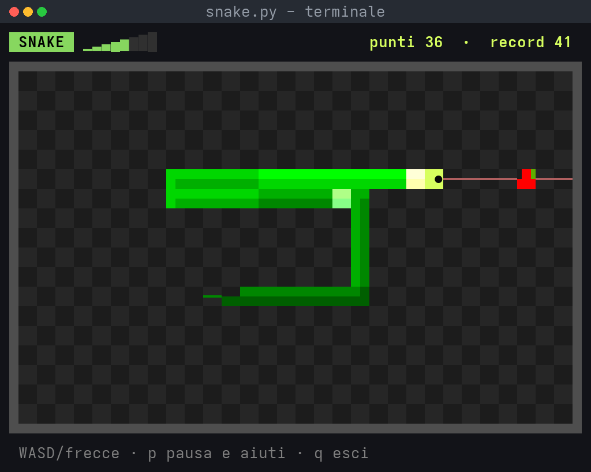
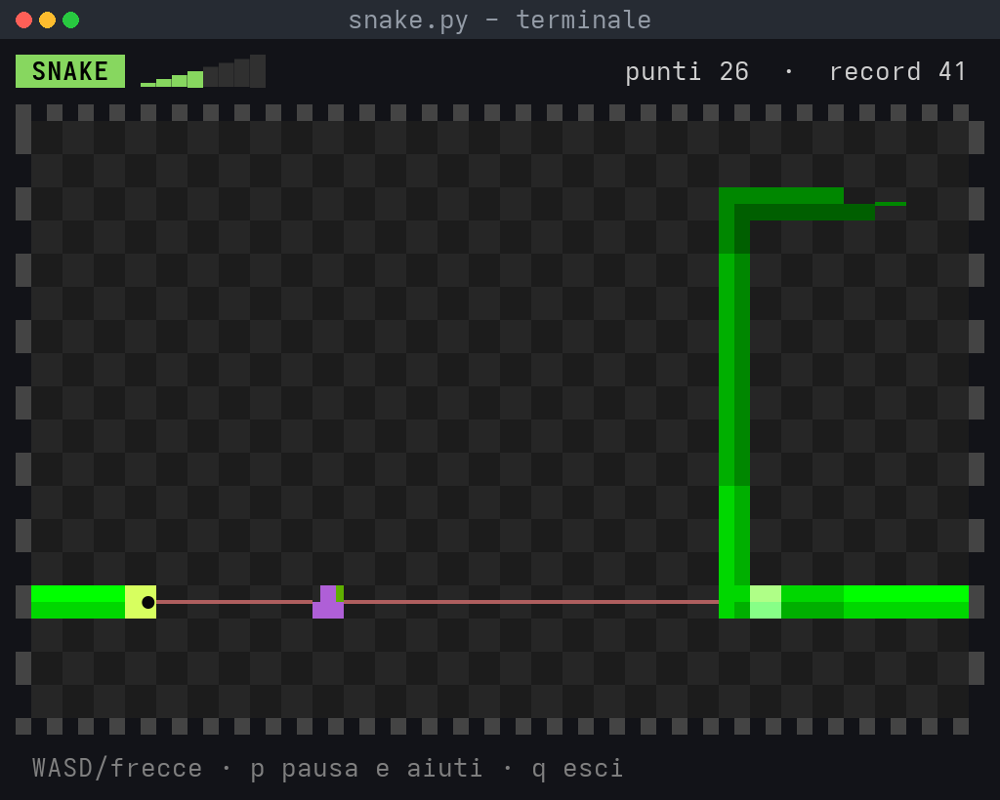

<div align="center">

# 🐍 snake-tui

**Il classico serpente nel tuo terminale** — puro Python 3 con `curses`, zero dipendenze da installare.


</div>

---

## 📸 Anteprima

Il gioco vive nel terminale (minimo **14×42** caratteri; più è grande, meglio si gioca). Ecco come appare in ogni stato:

<div align="center">

</div>

<div align="center">

<br><sub>con il <b>mirino laser</b> (tasto <code>m</code>): la linea si accende quando il frutto è sotto tiro; ogni boccone mangiato resta visibile finché non arriva alla coda</sub>
</div>

<div align="center">

<br><sub>con i <b>bordi aperti</b> (tasto <code>b</code>) si esce da un lato e si rientra dall'altro; il tachimetro in alto mostra la velocità (qui ridotta col <b>freno</b>, tasto <code>f</code>)</sub>
</div>

| Pausa | Game over |
|:--:|:--:|
|  |  |

<div align="center">

<br><sub>e se riempi proprio tutto il campo… 🏆</sub>
</div>

> Le immagini non sono "foto": sono generate dalla *vera* funzione `render()` del gioco — [vedi come](#-screenshot-come-sono-fatte).

### Anteprima testuale (se le immagini non si caricano)

```text
 SNAKE  ▁▂▃▄▅▆▇█   punti 14  ·  record 31
▄▄▄▄▄▄▄▄▄▄▄▄▄▄▄▄▄▄▄▄▄▄▄▄▄▄▄▄▄▄▄▄▄▄▄▄▄▄▄▄▄▄
█                                        █
█                                        █
█        █▀▀▀▀▀▀▀▀▀▀▀▀▀▀▀▀▀ ●            █
█        █                               █
█        █▀▀▀▀▀▀▀▄▄━━                    █
█                                ▟▙      █
█                                        █
▀▀▀▀▀▀▀▀▀▀▀▀▀▀▀▀▀▀▀▀▀▀▀▀▀▀▀▀▀▀▀▀▀▀▀▀▀▀▀▀▀▀
 WASD/frecce · p pausa e aiuti · q esci
```

## 🚀 Come iniziare

Niente da installare, niente venv:

```bash
python3 snake.py
```

Serve solo **Python 3** e un terminale che sappia mostrare Unicode (Linux, macOS o WSL). Dà il meglio con **256 colori** (praticamente tutti i terminali moderni: kitty, GNOME Terminal, iTerm2, Windows Terminal…); con 8 colori o in bianco e nero resta giocabile.

## 🎮 Controlli

| Tasto | Azione |
|:--:|:--|
| `↑` `↓` `←` `→` oppure `W A S D` | muovi il serpente |
| `m` | aiuto: **mirino laser** on/off, una linea mostra la traiettoria fino al muro |
| `b` | aiuto: **bordi aperti** on/off, si esce da un lato e si rientra da quello opposto |
| `f` | aiuto: **freno** on/off, il tasto opposto alla direzione di marcia rallenta il serpente |
| `p` | pausa / riprendi (il riquadro di pausa mostra quali aiuti sono attivi) |
| `r` | nuovo gioco (dopo game over o vittoria) |
| `q` | esci |

## 📜 Regole

- Ogni frutto mangiato (mela, arancia, prugna: si alternano) vale **+1 punto** e fa crescere il serpente: il boccone lampeggia e poi resta visibile, fermo dove è stato mangiato, finché la coda non lo raggiunge: è lì che il serpente si allunga.
- A ogni frutto il gioco **accelera**: da 130 ms per passo fino a 55 ms (il massimo).
- Muri e proprio corpo = **game over**.
- **Aiuti per chi inizia**, tutti spenti all'avvio e attivabili in qualsiasi momento (anche in pausa):
  - **mirino laser** (`m`): la traiettoria diventa più accesa quando punta dritta sul frutto;
  - **bordi aperti** (`b`): i muri diventano tratteggiati e si possono attraversare; resta solo il proprio corpo da evitare;
  - **freno** (`f`): ogni pressione del tasto opposto alla marcia rallenta di 15 ms (fino a 250 ms per passo); tenendolo premuto si frena progressivamente, ma il serpente non si ferma mai. I frutti poi riaccelerano come sempre.
- Riempi l'intero campo e vinci — in teoria. 😄
- Il record della sessione è sempre in alto a destra; ridimensionando il terminale si ricomincia da zero.

## 🧠 Come è fatto

Un solo file, due mondi separati:

| Pezzo | Ruolo |
|:--|:--|
| `Game` | logica pura (mosse, cibo, punteggio, collisioni) — **senza curses**, facile da testare in headless |
| `snake_cells()` | sceglie i glifi di ogni segmento: testa con occhi, corpo ombreggiato, coda affusolata |
| `render()` / `main()` | interfaccia TUI: muri, prato, frutti, riquadri di pausa / game over / vittoria |
| `make_pen()` | colori xterm-256 → coppie curses, allocate al volo (con ripiego a 8 colori e monocromatico) |
| costanti in testa al file | il "tuning" del gioco (`START_DELAY_MS`, `MIN_DELAY_MS`, `SPEEDUP_MS`, …) e la palette (`BODY`, `HEAD`, `FRUITS`, `ARENA_BG`, …) |

| Costante | Valore | Significato |
|:--|--:|:--|
| `START_DELAY_MS` | 130 | passo iniziale (ms) |
| `MIN_DELAY_MS` | 55 | velocità massima |
| `SPEEDUP_MS` | 4 | accelerazione per ogni cibo |
| `BRAKE_MS` | 15 | rallentamento per ogni colpo di freno |
| `MAX_DELAY_MS` | 250 | velocità minima raggiungibile col freno |
| `MIN_H × MIN_W` | 10 × 20 | campo minimo giocabile (in celle) |

### 🎨 La grafica

curses non permette di disegnare glifi propri: i caratteri li disegna il terminale con il suo font. Però Unicode offre già una "tavolozza" ricchissima, e i terminali moderni disegnano **blocchi** (`█ ▀ ▄ ▟ ▕ …`) e **linee** (`─ ━ ╭ …`) da soli, al pixel, senza passare dal font. Il gioco usa solo quelli, più un paio di simboli comuni (`● × ·`):

- **celle quadrate**: ogni cella del campo è larga 2 caratteri (un carattere è alto circa il doppio della larghezza), così il serpente si muove alla stessa velocità in orizzontale e in verticale;
- **2 colori per carattere**: con `▀ ▄ ▟ ▙ …` il colore di primo piano e quello di sfondo diventano "pixel" di mezza cella;
- **corpo a tubo**: metà in luce e metà in ombra (luce dall'alto a sinistra), con una sfumatura dalla testa alla coda; due tratti affiancati restano sempre distinguibili;
- **testa** gialla con gli occhi rivolti verso la direzione di marcia (`-` in pausa, `×` al game over); **coda** che si assottiglia (mezzo tubo, poi una linea);
- **mirino laser**: una linea sottile dalla testa al muro, sotto frutto e serpente; **boccone**: un lampo bianco che sfuma in verde chiaro e resta sul corpo finché non lo raggiunge la coda;
- **tachimetro** a 8 tacche (`▁▂▃▄▅▆▇█`) accanto al titolo; **muri tratteggiati** quando i bordi sono aperti;
- **frutti** a cupola con la foglia, **prato** a scacchiera, **muri** pieni e riquadri arrotondati per pausa / game over / vittoria.

## 📁 Struttura

```
snake-tui/
├── snake.py                     # il gioco: logica + TUI curses
├── scripts/
│   └── generate_screenshots.py  # rigenera le immagini del README
├── docs/                        # screenshot PNG (generate, non foto)
├── .gitignore
└── README.md
```

## 🖼️ Screenshot: come sono fatte

Le immagini in `docs/` sono **fedeli al gioco**: `scripts/generate_screenshots.py` fa passare la vera funzione `snake.render()` attraverso uno schermo simulato che cattura ogni carattere e i suoi colori, poi le ridisegna con Pillow dentro una finestra "stile terminale". Blocchi e linee vengono disegnati come rettangoli e archi, proprio come fanno kitty, VTE o Windows Terminal.

Per rigenerarle (serve solo Pillow):

```bash
pip install pillow
python3 scripts/generate_screenshots.py
```

---

<div align="center">

Fatto con 🐍 e `curses` — buon divertimento!

</div>
