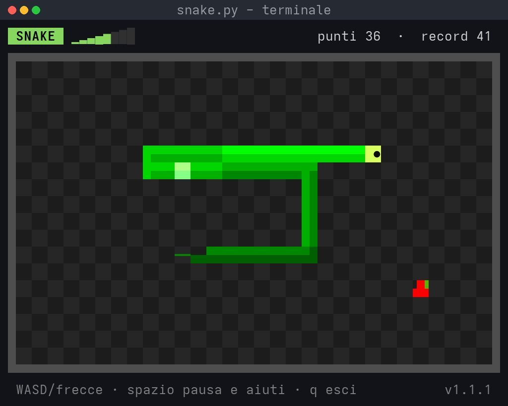
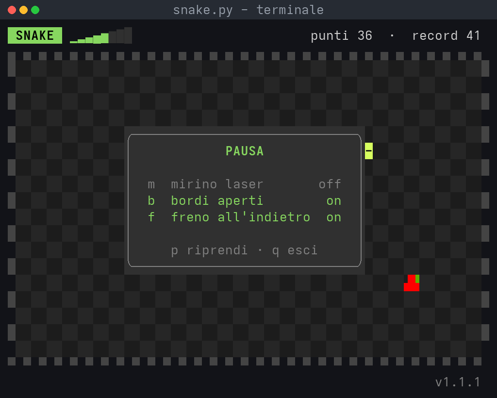
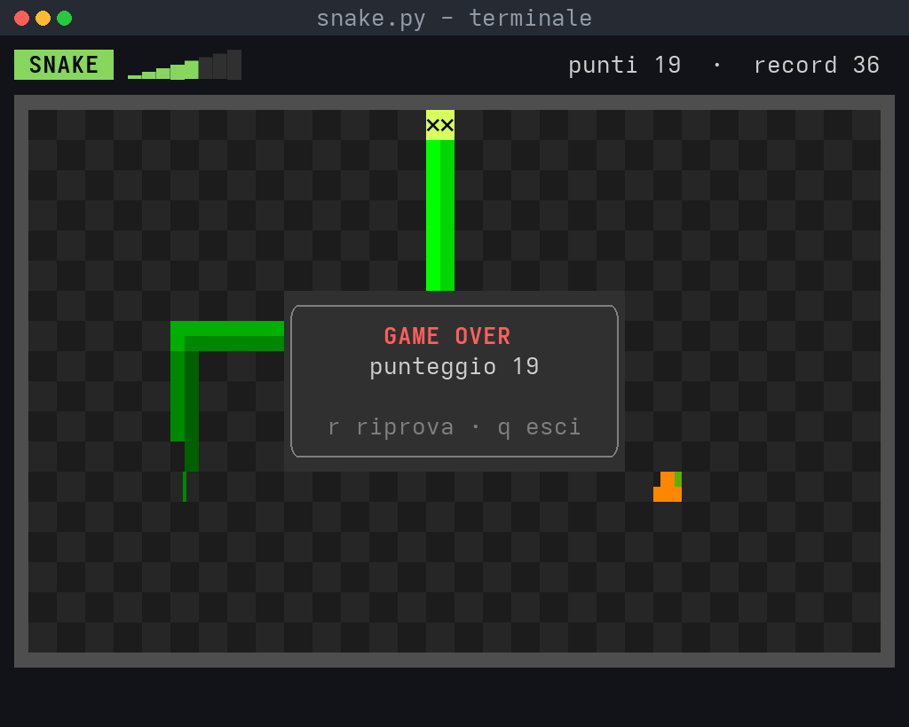
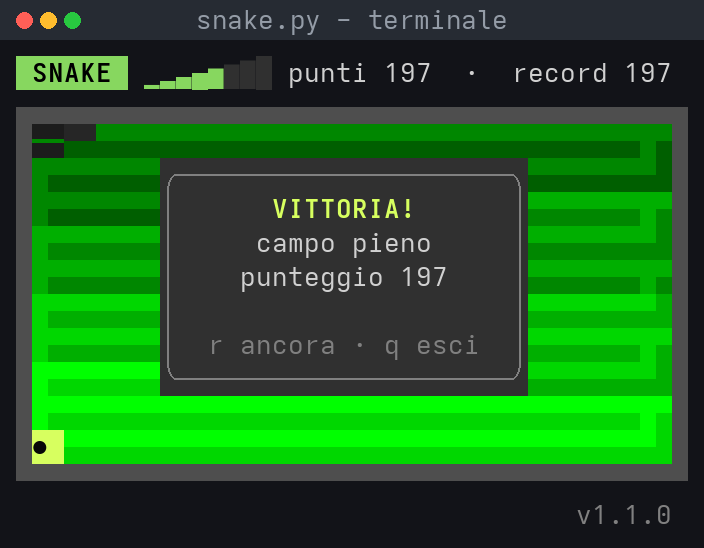

<div align="center">

# 🐍 snake-tui

**Il classico serpente nel tuo terminale** — puro Python 3 con `curses`, zero dipendenze da installare.


</div>

---

## 📸 Anteprima

Il gioco vive nel terminale (campo minimo **14×26** caratteri; più è grande, meglio si gioca). Ecco come appare in ogni stato:

<div align="center">

</div>

| Pausa | Game over |
|:--:|:--:|
|  |  |

<div align="center">

<br><sub>e se riempi proprio tutto il campo… 🏆</sub>
</div>

> Le immagini non sono "foto": sono generate dalla *vera* funzione `render()` del gioco — [vedi come](#-screenshot-come-sono-fatte).

### Anteprima testuale (se le immagini non si caricano)

```text
 SNAKE  punti: 7   record: 12
┌──────────────────────────────┐
│                              │
│        ████                  │
│           █████      ★       │
│              █               │
│                              │
│                              │
└──────────────────────────────┘
frecce/WASD muovi · p pausa · q esci
```

## 🚀 Come iniziare

Niente da installare, niente venv:

```bash
python3 snake.py
```

Serve solo **Python 3** e un terminale che sappia mostrare Unicode (Linux, macOS o WSL).

## 🎮 Controlli

| Tasto | Azione |
|:--:|:--|
| `↑` `↓` `←` `→` oppure `W A S D` | muovi il serpente |
| `p` | pausa / riprendi |
| `r` | nuovo gioco (dopo game over o vittoria) |
| `q` | esci |

## 📜 Regole

- Ogni `★` mangiato vale **+1 punto** e fa crescere il serpente.
- A ogni cibo il gioco **accelera**: da 130 ms per passo fino a 55 ms (il massimo).
- Muri e proprio corpo = **game over**.
- Riempi l'intero campo e vinci — in teoria. 😄
- Il record della sessione è sempre in alto a destra; ridimensionando il terminale si ricomincia da zero.

## 🧠 Come è fatto

Un solo file, due mondi separati:

| Pezzo | Ruolo |
|:--|:--|
| `Game` | logica pura (mosse, cibo, punteggio, collisioni) — **senza curses**, facile da testare in headless |
| `render()` / `main()` | interfaccia TUI: bordi, colori, overlay di pausa / game over / vittoria |
| costanti in testa al file | tutto il "tuning" del gioco (`START_DELAY_MS`, `MIN_DELAY_MS`, `SPEEDUP_MS`, …) |

| Costante | Valore | Significato |
|:--|--:|:--|
| `START_DELAY_MS` | 130 | passo iniziale (ms) |
| `MIN_DELAY_MS` | 55 | velocità massima |
| `SPEEDUP_MS` | 4 | accelerazione per ogni cibo |
| `MIN_H × MIN_W` | 10 × 24 | campo minimo giocabile |

## 📁 Struttura

```
snake-tui/
├── snake.py                     # il gioco: logica + TUI curses
├── scripts/
│   └── generate_screenshots.py  # rigenera le immagini del README
├── docs/                        # screenshot PNG (generate, non foto)
├── .gitignore
└── README.md
```

## 🖼️ Screenshot: come sono fatte

Le immagini in `docs/` sono **fedeli al gioco**: `scripts/generate_screenshots.py` fa passare la vera funzione `snake.render()` attraverso uno schermo simulato che cattura ogni carattere e attributo, poi le ridisegna pixel per pixel con Pillow dentro una finestra "stile terminale".

Per rigenerarle (serve solo Pillow):

```bash
pip install pillow
python3 scripts/generate_screenshots.py
```

---

<div align="center">

Fatto con 🐍 e `curses` — buon divertimento!

</div>
